# Production flow in Oryx: from product definition to finished goods

Prepared for product review. This describes what the system does today, in the order the work happens. It is written from the implemented behaviour of Oryx (the web application and the new desktop application share one backend and one set of rules).

## 1. The flow in one page

Production in Oryx has three stages. Each stage produces the input of the next.

| Stage | What it is | Who does it | What it produces |
| --- | --- | --- | --- |
| 1. Product definition | The master record of a product: what it is, what goes into it, how it is packed, and the steps to make it | Production planning, with QC for the test documents | A verified product that can be scheduled |
| 2. Production schedule | The plan: which products, how many batches, of what size, between which dates | Production planning | One planned batch per unit of work, each checked against material stock |
| 3. Production | Carrying out the product's procedure for one batch, step by step | Production floor, warehouse, QA and QC, each at their own steps | Packed, tested goods transferred to the finished goods warehouse |

```mermaid
flowchart LR
  A[Define product] --> B[Formula, packing, procedure, test documents]
  B --> C[Verify product]
  C --> D[Create schedule: products, batches, dates]
  D --> E[Check materials for each batch]
  E --> F[Start production of a batch]
  F --> G[Work through the procedure steps]
  G --> H[Final packing and reconciliation]
  H --> I[Transfer to finished goods warehouse]
```

The link between the stages is the **procedure**. The steps written on the product in stage 1 are exactly the steps a batch moves through in stage 3. A product with no procedure cannot be produced in a controlled way, and a change to the procedure changes how every later batch is run.

## 2. Stage 1: product definition

A product is defined once and then reused by every schedule. The definition has nine parts. The first is entered when the product is created; the rest are added by editing the product, each on its own tab.

### 2.1 Product information

The identity and the numbers everything else is calculated from.

- **Identity**: product name, product code, generic name, dosage form, department, division (beta-lactam or non-beta-lactam).
- **Units and quantities**: base unit, composition unit quantity, full batch size, filled volume or weight, price.
- **Storage and use**: storage condition, shelf life, action and use, equipment.
- **Compliance**: FDA registration number, master formula number, document number, revision number, label claims.

Rules:
- The product code is suggested from the company's code settings and can be changed. The backend decides whether a code is accepted.
- Quantities are entered in the base unit. The page shows the result as it is typed, for example "Full batch: 1,500 L. That is 300,000 composition units per batch."
- A full batch cannot be smaller than one composition unit. Quantities and price must be above zero.

### 2.2 Bill of materials (the formula)

The raw materials that make the product, in the order they are used.

- Each line has a material, its quantity per composition unit, unit, function, grade, and an optional substitute.
- The quantity for a whole batch is worked out: material per composition unit × (batch size ÷ composition size).
- A material appears once in a formula and cannot be its own substitute.
- Saving creates a new version. The formula can also be archived, which leaves the product with no active formula.

### 2.3 Packing materials

The packaging components (bottles, caps, labels, cartons, shippers).

- Each line has a component material, a packing style, a prescribed quantity and a packing allowance.
- A material is listed either once for all packing styles or once per style.

### 2.4 Packing styles

How the product is packed for sale, for example "10 × 10 blister in a carton, 50 cartons per shipper".

- A style is a label plus its packing units in order (unit and quantity at each level).
- Exactly one style is the default. A schedule uses the default unless another is chosen.
- An expected yield is suggested from the batch size ("a full batch fills about N base packs").
- A style already used in batch packaging records cannot be removed.

### 2.5 Packing order

Three written instructions for the packing team: primary pack, secondary pack and tertiary pack. All three are required.

### 2.6 Procedure (the steps and their activities)

This is the heart of the definition. The procedure is the ordered list of steps a batch must pass through.

**Each step has:**
- An **operation** (for example dispensing, granulation, compression, coating, packing). An operation is used once per procedure.
- One or more **work centres** where it is done.
- An **estimated time**.
- A flag: **critical** or **automated**.
- **Responsible parties**: users or roles, each with one **instruction** (the activity they must carry out at that step).

**The instructions (activities) a responsible party can be given:**

| Instruction | What it means on the production floor |
| --- | --- |
| BMR and BPR requisition or issue | Request the batch manufacturing and packaging records; QA issues them |
| Stock requisition or issue | Request the batch's materials; the warehouse issues them |
| Additional stock request or issue | Request extra material beyond the formula, with approval |
| ATR (analytical test request) | Ask QC to test the product at this stage (intermediate, bulk or finished) |
| Final packing and partial return | Record the yield, reconcile packaging materials, return leftovers |
| Transfer finished products | Send packed goods to the finished goods warehouse |
| Full return | Return every issued material and cancel the batch |
| Dispatch | Mark the batch as dispatched |

Rules:
- A responsible party must be complete: a user or role, and an instruction.
- An ATR instruction points to the product's analytical raw data for the stage being tested.
- An automated step cannot carry a main instruction.
- Steps are reordered by dragging, and numbered by their position when saved.
- A saved procedure can be copied to other products. Copying replaces the target product's whole procedure, and the page says so before it is done.

### 2.7 Test documents (with Quality Control)

Three records tie the product to its quality standard.

- **STP (standard test procedure)**: one per product. An STP number, a summary, and a controlled document with versions. Replacing an approved document needs a reason, and a document under review cannot be replaced.
- **Specification**: one per test stage (intermediate, bulk, finished). Number, revision, effective and revision dates, what it supersedes, and the template form used to record results.
- **ARD (analytical raw data)**: one per test stage. It takes its STP from the product and its template from that stage's specification. This is what the ATR step in the procedure points to.

### 2.8 Verification

A product is created unverified. A user with the verify permission checks it and marks it verified. Verification is the control point between definition and planning.

### 2.9 Product record

The product page shows everything above in one place: summary, active and outdated formulas, packaging, packing styles, procedure, STP, specifications and ARD.

## 3. Stage 2: production schedule

A schedule is the plan for a period. It answers: which products, how many batches, what size, between which dates.

### 3.1 What a schedule contains

- A schedule code, start date, end date and remarks.
- One or more product lines. Each line has a product, number of batches, batch size (full or half), packing style and market type.

The system creates **one planned batch for each batch counted on a line**. Three batches of a product become three separate batches, each of which is started, tracked and completed on its own. The batch quantity comes from the product's full batch size, halved for a half batch.

### 3.2 Material forecast

Before a schedule is saved, each product line can be forecast. The forecast shows what the chosen batches need of every raw and packaging material, set against warehouse stock.

- Materials that are short are listed first, with how much is missing.
- Reserved stock is shown.
- A material counts as available only when usable stock is more than what is needed. Exactly enough is shown as short, with nothing to spare.

### 3.3 Managing a schedule

- **Edit dates and remarks**: allowed only while the start date is still in the future.
- **Add products**: more product lines can be added to a schedule.
- **Remove products**: batches not yet started can be taken off. Batches in production or cancelled are locked.
- A schedule's state is shown as upcoming, in progress or ended. An ended schedule is closed to changes.

### 3.4 From plan to production

The schedule page lists every batch beside its details: product facts, raw material needs, packaging material needs, and stock for each.

A batch can be **started** when its materials are covered. A material is covered by what is reserved for the batch plus warehouse stock not reserved by any other batch. When something is short, the page says how many materials are short and why Start is unavailable.

Starting production:
- Asks for confirmation.
- Creates the production run for that batch, with one step for every step of the product's procedure.
- Cannot be undone by removing the batch. A started batch can only be ended through the production process itself.

A batch not started before its schedule ended is marked as such and cannot be started.

## 4. Stage 3: production

### 4.1 The production board

The board shows every running batch of the department, in a column for the operation it is currently at. Each card shows the batch number, product, size, schedule, the step's status, how long it has been there, and who is responsible. The board refreshes by itself.

### 4.2 A batch and its steps

Opening a batch shows its facts, a progress bar (steps completed out of all steps), every step in order with its status, duration and people, and the activity log of who did what and when.

A step is in one of five states: not started, in progress, completed, delayed, cancelled.

### 4.3 What happens at each step

A batch moves through its procedure one step at a time. What a person does at a step depends on the instruction they hold there.

| Instruction at the step | What is done | How the step moves on |
| --- | --- | --- |
| No record of its own (a plain manufacturing step) | The responsible person starts the step, does the work, and completes it | By hand: Start, then Complete |
| Stock requisition | One voucher is raised for every material the batch needs. The warehouse issues the stock | Starts when the voucher is raised, finishes when the stock is issued |
| BMR and BPR requisition | The batch records are requested; QA issues them | Follows the batch record's status |
| Analytical test request | The product state and filled volume are entered and sent to QC | Follows the test request: sampled, acknowledged, testing, released or rejected |
| Extra material request | Extra quantities are entered for the materials that need more; the request goes for approval | The step cannot start while a request is waiting for approval |
| Final packing | Yield and packaging reconciliation are recorded (see 4.4) | Finishes when the packing record is saved |
| Finished goods transfer | Packed goods are sent to the finished goods warehouse, all at once or in parts | Finishes when everything packed has been transferred |
| Full return | Every issued material is returned and the batch's production is cancelled, with a reason | Ends the batch |
| Dispatch | The batch is marked dispatched | By hand: Start, then Complete |

### 4.4 Final packing

Final packing is where the batch is accounted for.

- **Entered**: quantity received for packing, quantity packed, rejected, sampled, and the packaging materials used.
- **Calculated by the system**: expected packs, quantity after samples, gain or loss, number of shippers, leftovers, what must be returned, and the loss on each packaging material.
- Packed, rejected and sampled together cannot be more than what was received.
- The packing record is saved first, then leftover materials are returned to the warehouse. If the return fails, the page says the packing was saved and offers to send only the return again.
- Once recorded, the record is shown and cannot be entered a second time.

### 4.5 Transfer to the finished goods warehouse

A finished goods transfer note is raised for the packed quantity. It can cover the whole batch or part of it, and the remainder can follow in a later note. The finished goods warehouse confirms the physical quantity and approves the note, at which point the goods are in its stock and available to sales orders.

## 5. Controls built into the flow

These apply wherever a step is shown.

- **Nothing changes because a page was opened.** Every start, completion, request and return is a deliberate action by a person.
- **A critical step can only be carried out by the people responsible for it.** Others see the step but cannot act on it.
- **Only the batch's current step can be acted on.** Steps cannot be done out of order.
- **Steps tied to a record move with that record.** A stock requisition step cannot be marked complete by hand; it completes when the warehouse issues the stock. The same holds for batch records, test requests, final packing and transfers.
- **Irreversible actions ask first.** Completing a step, starting production and returning all materials each need confirmation.
- **Permissions are separate for each action.** Viewing, creating, editing, verifying a product, creating a schedule, and adding or removing schedule products are each granted on their own.
- **Every action is logged** on the batch with the person and the time.

## 6. How the three stages depend on each other

| If this is missing on the product | Then |
| --- | --- |
| Full batch size | The product cannot be scheduled |
| Bill of materials | A batch has no material needs to check or request |
| Packing style | A schedule line cannot be completed |
| Procedure | A started batch has no steps to work through |
| ARD for a stage | The test request for that stage cannot be raised |
| Specification with a template | The ARD for that stage cannot be created |

## 7. Known gaps and points for review

These are honest limits of the current system, worth a product decision.

1. **Saving a formula removes its earlier versions.** The "outdated formulas" history is empty after any save; only an archived formula that has not been saved over remains. For a regulated product this weakens the change history.
2. **Saving a procedure replaces every step.** Resources attached to a step do not survive a save.
3. **Editing a specification changes every specification with the same number, across products.**
4. **"Exactly enough" stock counts as short.** A batch needing 100 kg with exactly 100 kg free cannot be started.
5. **A schedule's products and code cannot be changed after creation** through the edit action; only dates and remarks can.
6. **Dispatch has no record behind it.** It is a start-and-complete step only.
7. **Not yet available in the desktop application** (still done in the web application, on the same data): the purchase requisition raised from a batch that is short of materials, the schedule product flow and product requisition pages, the activity details page, the monthly schedule report, the product print preview, and the Quality Control screens where a specification's test parameters are filled in.

## 8. Glossary

| Term | Meaning |
| --- | --- |
| BOM | Bill of materials: the product's formula |
| BMR / BPR | Batch manufacturing record / batch packaging record |
| STP | Standard test procedure |
| ARD | Analytical raw data: the form on which test results are recorded |
| ATR | Analytical test request: production asking QC to test a batch |
| FGTN | Finished goods transfer note |
| Composition unit | The quantity the formula is written for, for example per 1,000 tablets |
| Critical step | A step only its named responsible people may carry out |
