# Oryx reporting and KPI study

Study started 2026-11-02. Status: source-based discovery and proposed report
contracts, **not authorization to implement every proposal**. No customer data
was read for this study. Existing uncommitted BMR report work is preserved.

The objective is to understand each business workflow, identify the reports that
support its decisions, agree their columns and meanings, then implement and
accept one module at a time. A dashboard number without its detail rows and
definition is not a completed reporting requirement.

## Study documents

- [Module report and KPI catalogue](module-catalogue.md): candidate reports,
  columns, row grain, filters, KPI definitions and gaps for 16 business areas.
- [QA detailed specification](modules/01-quality-assurance.md): first module for
  review, including the agreed BMR print grouping and issuance/release distinction.
- [Source inventory](source-inventory.md): all 16 navigation groups, 151 feature
  manifests, 362 workspace pages, 34 desktop report choices, and the selected
  backend report/dashboard contract index with exposed response properties.
- [Report specification template](report-specification-template.md): the contract
  each approved report must satisfy before implementation.

Counts describe the inspected working tree, not deployed features. Main and
Reports are aggregation surfaces. Inventory & Stores is split into stock and
services for review; Human Resource is split into HR and payroll/performance.
This yields 16 business review areas from the 16 navigation groups without
pretending that 151 small technical modules are 151 independent businesses.

## Business evidence chain

This is an initial ownership map, not a claim that every cross-module join has
already been reconciled. Each arrow needs document/line identity in its reports.

```mermaid
flowchart LR
    Orders[Customer orders] --> Plan[Production planning]
    Master[R&D and controlled definitions] --> Plan
    Plan --> Demand[Material demand]
    Demand --> Buy[Procurement]
    Buy --> Inbound[Logistics and receiving]
    Inbound --> QC[QC testing and quality decisions]
    QC --> Stock[Usable warehouse stock]
    Stock --> Run[Production execution]
    Plan --> QA[QA document issue]
    QA --> Run
    Run --> Tests[Stage tests and batch release]
    Tests --> FG[Accepted finished goods]
    FG --> Dispatch[Allocation and dispatch]
    Dispatch --> Invoice[Customer invoices]
    Invoice --> Finance[Approved receipts and cashflow]
    Buy --> Finance
```

HR/payroll supply workforce and payment evidence; stores/services support
operations; audits/CAPA, approvals, access and controlled setup govern the chain.
They retain their own report grains rather than being collapsed into a single
operational KPI.

## What has been studied, and what remains

The first pass inventories navigation, module ownership, the report catalogue,
OpenAPI parameters/DTOs, representative operational models, workflow migration
notes, and selected repository calculations. QA issuance, testing stages,
production quantities, warehouse movements, cashflow, payroll, supplier evidence,
audit CAPA and R&D stability have source anchors in the catalogue.

It is not yet an exhaustive review of every mutation, every caller, deployed
permissions or customer data quality. Backend endpoint presence, a DTO property
and an old migration note do not establish a correct production report. Each
module still needs its full query/event trace, realistic data reconciliation and
business review before its proposed contracts become accepted requirements.

## Review order

| Wave | Business areas | Reason |
| --- | --- | --- |
| 1 | QA, then QC | Start from the requested BMR report; separate document issuance, testing and quality release. |
| 2 | Production, then warehouse | Reconcile plans, material requirements, reservations, issues, consumption, returns and output. |
| 3 | Procurement, suppliers and logistics | Trace shortages and purchasing through arrival, receipt, clearance and storage. |
| 4 | Finished goods/CRM, then finance | Reconcile accepted output, allocations, dispatch, invoices and approved settlements. |
| 5 | Inventory/stores, then services | Separate stock movements from service execution and approved costs. |
| 6 | HR, then payroll/performance | Agree roster/attendance denominators and protect employee/payroll detail. |
| 7 | R&D, audits, IT/access, master data | Complete lifecycle, effectiveness, traceability and governance reporting. |

This is a proposed sequence, not an automatic implementation queue. QA is detailed
first because it is the current reporting request; other modules remain candidates.

## Decisions required for every report

1. **Question and owner:** who uses it and what action it supports.
2. **Row grain:** one BMR, one batch, one material allocation, one invoice line,
   one payment, one person/day, etc. Define the stable identity before joining.
3. **Columns:** stored facts, safely derived values, labels, units, currencies,
   missing-value behavior, confidential fields and drill-through identifiers.
4. **Time basis:** named event date, current snapshot or supported recorded
   historical snapshot. Creation, approval, issue, release and posting differ.
5. **Filters:** date boundaries/time zone, department/site and relevant record
   kinds/statuses. Omitted filters never bypass authorized scope.
6. **Totals/KPIs:** numerator, denominator, grouping, exclusions and zero/no-data
   behavior. A KPI needs the detail rows that reconcile to it.
7. **Evidence:** authoritative entities, exact relationships, query implementation,
   event/audit history, legacy gaps and current versus issue-time master labels.
8. **Permission and output:** backend grant/department rules, confidential exports,
   screen columns, grouped print cells and independent Excel/CSV columns.
9. **Acceptance:** sample records and expected results, missing/duplicate/archived
   evidence, state transitions, date edges, reconciliation and repeat generation.

## Rules that apply across modules

- Period flow reports select the event they describe. Snapshot backlogs include
  still-open work from earlier periods; a creation-date filter alone is not an
  end-of-period backlog. Historical snapshots require recorded state coverage.
- Define inclusive calendar dates and one time zone. A new report should use
  start-of-first-day through, but excluding, start-of-day-after-end. Existing
  endpoint boundary behavior must be checked before reuse.
- Count stable IDs at the declared grain. Joins to approvals, test stages,
  shipments, stock lots and line items must not multiply headers or quantities.
- Keep quantities grouped by material/product and compatible unit; never sum kg,
  litres, pieces or pack/shipper meanings into a company-wide quantity. Keep
  currencies separate unless conversion date/rate and missing-rate rules exist.
- A release, reservation removal, stock issue, consumption, return, transfer and
  adjustment are different events. Approved is not issued; issued is not consumed;
  invoice is not payment; payment pending approval is not a posted settlement.
- Unknown data remains unknown. A zero denominator is N/A with its component
  counts, not automatically 0% or 100%. Missing dates/units/rates need an exception
  column/count rather than silent exclusion or a guessed value.
- No unapproved targets or traffic-light limits. First agree the definition and
  establish a trustworthy baseline, then the business sets its target.
- Screen, print and export use the same validated snapshot and retain filters,
  generation time, scope and relevant caveats. Exports include every matched row,
  not the current screen page. Group print fields without losing spreadsheet data.
- Current entity names/statuses are not necessarily historical facts. State which
  labels are current and which values/versions were captured at the event.
- Use existing report/domain permissions; assess backend enforcement per query.
  Broad report access does not automatically permit payroll, bank, health or
  other confidential employee/customer detail. Do not invent permission keys.

## Findings that can mislead reports today

| Finding | Evidence | Consequence for study |
| --- | --- | --- |
| BMR issuance and quality release have different evidence. | Local issued report uses `IssuedDate`; `GetBmrReleaseRate` counts `Approved`/`Available`, filters by `ManufacturingDate`, and returns that count as `Issued`. | Define and label separate measures. Do not compare them as the same period/denominator. |
| Active BMR queue drops completed steps. | `GetBatchManufacturingRecords` filters out steps with `CompletedAt`. | An issued-history report must not reuse that queue. |
| The legacy issue writer can overwrite an earlier issue stamp. | `IssueBatchManufacturingRecord` writes the current timestamp/issuer; desktop prevents normal repeat issue. | Latest recorded issuance is available; a complete reissue-event history needs separate evidence. |
| A stored issue timestamp is not necessarily a QA-performed event. | `ProductRepository` product-stock upload creates approved BMR/BPR records with `IssuedDate = UtcNow`, without `IssuedById`. | QA-01 needs an explicit provenance decision before QA-only acceptance; a missing issuer alone cannot safely identify an import. |
| QA approval totals repeat one source. | `GetQaDashboardReport` adds `purchaseOrderApprovals.CountAsync` twice in total, pending and rejected expressions. | Reconcile distinct approval-stage populations before reusing these dashboard totals. No fix is made in this study. |
| Existing quantity KPIs need dimensional review. | Material-return KPI sums transfer quantities and return-note quantities by department; yield KPI reads selected packing yield and final-packing quantities. | Verify compatible units, scope, half batches and packing definitions before presenting a rate. |
| Some KPI names promise more than the measured stage. | Dock-to-stock DTO/controller descriptions refer to arrival-to-GRN generation. | Separately define receiving time and time to usable shelf stock; confirm the called overload. |
| Metadata and runtime shapes can differ. | Supplier-material and employee-movement reports already use contract adapters. | Trace repository results, not only Swagger, before declaring available columns. |
| Current masters do not recreate historical configuration. | BMR/product links and readiness reports resolve current master data; repair changes are on separate PRs. | Do not assume applied snapshots/release markers exist in the deployed database. |
| Finance pricing is not a complete product-cost ledger. | List price/customer agreement logic selects selling prices/currencies. | Do not label a price-based calculation gross margin or manufacturing cost. |
| Legacy and rebuilt QC objects coexist in source. | `AnalyticalTestRequest`/legacy OOS plus `QcWorksheets` test requests, worksheets, OOS cases and COAs. | Keep engine/version/subject identity explicit until migration and deduplication are verified. |

These are source findings and review blockers, not a claim that every affected
customer record is wrong. This study makes no fixes to those calculations.

## Module completion gate

For each module: trace its full workflow and source joins; agree the report list
and priorities; fill the specification for each selected report; reconcile a
representative fixture to operational documents; implement only accepted contracts;
then verify permissions, totals, dates and exports before moving to the next
module. Data gaps stay in the backlog with an owner; they are not filled with
plausible-looking values.

The immediate review pack is [QA](modules/01-quality-assurance.md). The existing
local BMR issued report supplies its first concrete specification; the other QA
reports and KPIs are proposals for review.
